# 🤖 Awesome Customer Support & Service Automation 🚀

<div align="center">

<a href="https://github.com/ishandutta2007/Awesome-Awesome-Awesome"></a><a href="https://discord.gg/jc4xtF58Ve"></a>
[](https://github.com/ishandutta2007/Awesome-Customer-Support-Service-Automation/stargazers)
[](https://github.com/ishandutta2007/Awesome-Customer-Support-Service-Automation/network/members)
[](LICENSE)
<a href="https://github.com/ishandutta2007"></a>

<br/><br/>

<a href="#readme">
  
</a>

<br/><br/>

**A curated index of leading SaaS platforms and open-source software powering modern AI agents, ticket triage, omnichannel helpdesks, and customer service automation workflows.**

[Explore SaaS](#-saas-products--hosted-platforms) • [Open-Source Solutions](#-open-source-github-projects) • [Market Dynamics](#-sector-overview--market-dynamics) • [Contributing](#-how-to-contribute) • [Support](#-support)

</div>

---

## 🧭 Table of Contents

- [📊 Sector Overview & Market Dynamics](#-sector-overview--market-dynamics)
- [☁️ SaaS Products & Hosted Platforms](#-saas-products--hosted-platforms)
- [💻 Open-Source GitHub Projects](#-open-source-github-projects)
- [🛠️ Architecture & Deployment Patterns](#-architecture--deployment-patterns)
- [🤝 How to Contribute](#-how-to-contribute)
- [📈 Star History](#-star-history)
- [☕ Support](#-support)
- [⚖️ Disclaimer](#️-disclaimer)

---

## 📊 Sector Overview & Market Dynamics

> 💡 **Market Size & Velocity:** The global customer service software and support automation market is estimated at **$51B–$55B in 2026**, on a clear trajectory to eclipse **$95B+** over the next decade at a compound annual growth rate (CAGR) of ~14–16%, spurred by autonomous generative AI agents, automated resolution engines, and real-time voice triage.
>
> 🌐 **Market Concentration & Structure:** The industry remains **moderately fragmented**: massive enterprise incumbents like **ServiceNow** and **Zendesk** anchor core operational workflows in the Fortune 2000, yet the rapid emergence of agentic AI native platforms (e.g., **Fin/Intercom**, **Ada**) and extensible open-source stacks (e.g., **Chatwoot**, **Zammad**, **Libredesk**) prevents a simple "winner-take-all" consolidation. Mid-market and SMB buyers increasingly leverage best-of-breed outcome-based AI or sovereign self-hosted solutions rather than all-in-one monoliths.

---

## ☁️ SaaS Products & Hosted Platforms

Enterprise customer support and CX platforms sorted by company scale (market capitalization / valuation in descending order):

| Product | Valuation / Revenue | Starting Pricing | Free Tier / Free Trial Limits | Description |
|:---|:---|:---|:---|:---|
| **[ServiceNow CSM](https://www.servicenow.com/)** | **~$105B Market Cap** *(NYSE: NOW, ~$10.9B ARR)* | **$130/fulfiller/month** (Customer Service Management Standard list estimate, billed annually) | **No free tier**; custom sandbox available only via enterprise sales demonstration | Enterprise-grade digital workflow engine connecting front-line customer service cases directly to IT, HR, and back-office operations with Now Assist AI. |
| **[Zendesk](https://www.zendesk.com/)** | **$10.2B Valuation** *(acquired by Hellman & Friedman, ~$1.7B ARR)* | **$19/agent/month** (Support Team, annual billing; Suite Team omnichannel starts at $55/agent/month) | **14-day free trial** (Full access to Suite Professional features; extendable up to 28 days; no credit card required) | Full-lifecycle omnichannel customer support software featuring intelligent ticket routing, AI bots, workforce management, and automated macros. |
| **[Intercom](https://www.intercom.com/)** | **$3.6B Valuation** *(~$340M+ ARR)* | **$29/seat/month** (Essential tier, annual billing) + **$0.99 per autonomous Fin AI resolution** | **14-day free trial** (Cardless access to Essential/Advanced features and Fin AI resolution credits) | AI-first customer experience platform centered on the **Fin AI agent**, delivering conversational triage, omnichannel inboxes, and automated self-service. |
| **[Freshdesk](https://www.freshworks.com/freshdesk/)** | **~$3.3B Market Cap** *(NASDAQ: FRSH, ~$700M+ ARR)* | **$19/agent/month** (Growth tier, annual billing; Pro tier at $55/agent/month) | **14-day full feature trial**; also offers a restricted **Free Program for up to 2 agents** (capped at 6 months, basic email/social ticketing) | Cloud helpdesk featuring Freddy AI for instant deflection, ticket routing rules, collaborative team inboxes, and integrated analytics. |
| **[Ada](https://www.ada.cx/)** | **$1.2B Valuation** *(Series C unicorn, ~$202M raised)* | **~$2,500/month** (~$30,000/year minimum baseline contract commit) | **No free tier or public self-serve trial**; guided proof-of-concept evaluation available upon enterprise sales demo | Enterprise AI agent platform for automating complex customer support conversations across web chat, SMS, social channels, and voice without code. |
| **[Gorgias](https://www.gorgias.com/)** | **~$600M Valuation** *(Series C, ~$70M ARR)* | **$10/month** (Starter tier, includes 50 tickets/month; Basic tier starts at $60/month for 300 tickets) | **7-day free trial** (Includes standard helpdesk capabilities and ticket automations; no credit card required) | E-commerce-specialized helpdesk deeply integrated with Shopify, BigCommerce, and Magento with auto-refunds, order tracking, and machine learning macros. |
| **[Kustomer](https://www.kustomer.com/)** | **~$250M Valuation** *(independent spin-out, Series B, ~$25M ARR)* | **$89/user/month** (Enterprise tier, annual commitment with standard 8-seat minimum, ~$8,544/year) | **30-day free trial** for Kustomer AI features; core CRM platform offers guided demo upon sales request | Omnichannel CRM delivering single-timeline views of customer interactions, continuous intent detection, and automated conversational routing. |
| **[LivePerson](https://www.liveperson.com/)** | **~$36M Market Cap** *(NASDAQ: LPSN, ~$300M revenue)* | **~$2,000–$5,000/month** (Quote-based enterprise licensing, ~$60,000+ average annual deployment) | **No self-serve free tier**; evaluation sandbox configured only via sales consultation | Conversational AI and digital engagement suite automating voice-to-messaging deflection, bot-to-agent handoffs, and commerce workflows. |

---

## 💻 Open-Source GitHub Projects

Self-hosted, transparent, and privacy-preserving helpdesk and support automation frameworks sorted by GitHub community popularity (stargazers count descending):

| Repository | GitHub_Stars_Badge | Tech Stack | License | Description & Automation Highlights |
|:---|:---:|:---:|:---:|:---|
| **[Chatwoot](https://github.com/chatwoot/chatwoot)** | [](https://github.com/chatwoot/chatwoot/stargazers) | Ruby on Rails, Vue.js | AGPL-3.0 | 🌟 Open-source customer engagement suite and alternative to Intercom and Zendesk. Features live chat widgets, unified omnichannel inboxes (WhatsApp, Twitter, Email, Facebook), Captain AI assistant bot, workflow auto-assignments, and webhook triggers. |
| **[Papercups](https://github.com/papercups-io/papercups)** | [](https://github.com/papercups-io/papercups/stargazers) | Elixir, Phoenix, React | MIT | 💬 Modern open-source customer messaging platform. Embeddable chat widgets, Slack bi-directional sync, custom event triggers, and support automation built with high-concurrency architecture. |
| **[Zammad](https://github.com/zammad/zammad)** | [](https://github.com/zammad/zammad/stargazers) | Ruby on Rails, GraphQL | AGPL-3.0 | 🛡️ Web-based open-source ticketing system for enterprise support desks. Delivers automated SLA escalation, smart auto-assignment rules, time tracking, full audit trails, and multi-channel connectors (Email, Chat, Telephone/CTI, Social). |
| **[FreeScout](https://github.com/freescout-helpdesk/freescout)** | [](https://github.com/freescout-helpdesk/freescout/stargazers) | PHP (Laravel), MySQL | AGPL-3.0 | 📬 Lightweight self-hosted help desk and shared inbox. Zero seat fees, modular ecosystem with 50+ community plugins (Auto-responder, Custom Fields, SLA Rules, Telegram/WhatsApp notifications, Satisfaction Surveys). |
| **[osTicket](https://github.com/osTicket/osTicket)** | [](https://github.com/osTicket/osTicket/stargazers) | PHP, MySQL | GPL-2.0 | 🎫 Battle-tested open-source customer support ticket system. Features ticket filters, auto-responder workflows, SLA management, interactive customer self-service knowledgebase, and role-based permissions. |
| **[Chaskiq](https://github.com/chaskiq/chaskiq)** | [](https://github.com/chaskiq/chaskiq/stargazers) | Ruby on Rails, React | AGPL-3.0 | ⚡ Full-featured conversational marketing, chat, and support messaging platform. Includes bot-builder automation, campaign triggers, onboarding tours, and integrations with WhatsApp, Twitter, and Slack. |
| **[Frappe Helpdesk](https://github.com/frappe/helpdesk)** | [](https://github.com/frappe/helpdesk/stargazers) | Python, Frappe, Vue.js | GPL-3.0 | 🏢 High-velocity helpdesk built on the Frappe framework. Features business-hours SLAs, automatic assignment matrix by priority/agent load, native customer master sync with ERPNext, and unlimited agents without licensing fees. |
| **[Libredesk](https://github.com/abhinavxd/libredesk)** | [](https://github.com/abhinavxd/libredesk/stargazers) | Go, Alpine.js, SQLite | MIT | 🚀 High-performance, zero-dependency omnichannel desk packaged into a single Go binary. Provides live webchat, canned responses, auto-routing rules, and low memory footprints for sovereign cloud edge deployments. |
| **[Helpy](https://github.com/helpyio/helpy)** | [](https://github.com/helpyio/helpy/stargazers) | Ruby on Rails, PostgreSQL | MIT | 📚 Modern open-source helpdesk with embedded knowledgebase, multi-lingual support, email ticket synchronization, and community forum discussions designed for frictionless self-hosting. |
| **[Live Helper Chat](https://github.com/livehelperchat/livehelperchat)** | [](https://github.com/livehelperchat/livehelperchat/stargazers) | PHP, React, Node.js | Apache-2.0 | 📞 Open-source live support chat system featuring proactive invitations, automated voice/video calls, Telegram/WhatsApp bot integrations, and custom auto-responders. |
| **[TGO](https://github.com/tgoai/tgo)** | [](https://github.com/tgoai/tgo/stargazers) | Python, FastAPI, React | MIT | 🤖 Multi-agent AI orchestration platform connecting LLMs (OpenAI, Anthropic) with Model Context Protocol (MCP) toolkits. Implements automated RAG document search, autonomous ticket triage, and seamless human agent handoffs. |
| **[Znuny](https://github.com/znuny/Znuny)** | [](https://github.com/znuny/Znuny/stargazers) | Perl, JavaScript, MariaDB | GPL-3.0 | ⚙️ Community-driven LTS fork of OTRS. Robust ITIL-compliant service management and customer support ticketing with extensive event-based routing, process automation, and customer portals. |
| **[Owly](https://github.com/Hesper-Labs/owly)** | [](https://github.com/Hesper-Labs/owly/stargazers) | Next.js, Node.js, PostgreSQL | MIT | 🦉 Autonomous AI customer support agent with native WhatsApp, telephone voice bot, and email connectors. Implements OpenAI GPT function calling, RAG knowledge ingestion, auto-tagging, and CSAT metrics. |
| **[Chatty](https://github.com/PersonaliAI/chatty)** | [](https://github.com/PersonaliAI/chatty/stargazers) | Next.js, Supabase, Tailwind | MIT | 🧪 Self-hostable AI customer support engine with real-time audio voice mode, shared inbox, multimodal RAG retrieval, and MCP tool execution runnable on Docker Compose, Railway, or Render. |
| **[Inbxer](https://github.com/inbxer/inbxer)** | [](https://github.com/inbxer/inbxer/stargazers) | PHP (Laravel), Vue.js, Redis | MIT | 🎯 Account-aware AI support for B2B SaaS. Features six dedicated AI agents that prepare draft replies, conversation summaries, sentiment triage, and urgency flags while keeping humans strictly in control of final outbound messages. |

---

## 🛠️ Architecture & Deployment Patterns

Support automation systems typically combine several architectural layers:

```text
       ┌────────────────────────────────────────────────────────┐
       │   Customer Touchpoints: Chat, Email, Voice, WhatsApp   │
       └───────────────────────────┬────────────────────────────┘
                                   │
                                   ▼
       ┌────────────────────────────────────────────────────────┐
       │     Omnichannel Ingestion & Webhook Event Gateway      │
       └───────────────────────────┬────────────────────────────┘
                                   │
                 ┌─────────────────┴─────────────────┐
                 ▼                                   ▼
   ┌───────────────────────────┐       ┌───────────────────────────┐
   │ Autonomous AI Agent (RAG) │       │ Rules Engine / Auto-Route │
   │ Intent, Drafting & Tool   │       │ SLA Timers, Queues, Tags  │
   └─────────────┬─────────────┘       └─────────────┬─────────────┘
                 │                                   │
                 └─────────────────┬─────────────────┘
                                   │
       ┌───────────────────────────▼────────────────────────────┐
       │  Unified Human Agent Workspace (Zammad/Chatwoot/Go)    │
       │  Review Drafts • Approve Responses • Resolve Incidents │
       └────────────────────────────────────────────────────────┘
```

- **Data Sovereignty & Compliance:** Self-hosted open-source stacks (such as Chatwoot, Zammad, or FreeScout) ensure GDPR, HIPAA, and SOC-2 data residency compliance without sending sensitive customer transcripts to third-party per-resolution cloud providers.
- **Outcome-Based vs. Seat-Based Economics:** Commercial AI agents like Intercom Fin ($0.99/resolution) offer fast ROI for peak volumes, while open-source agents (Owly, Inbxer, TGO) enable zero marginal cost per resolution by connecting directly to private LLM backends (Ollama, vLLM, or self-hosted API endpoints).

---

## 🤝 How to Contribute

We welcome additions, corrections, and improvements from CX leaders, DevOps engineers, and developers:

1. **Fork** this repository.
2. **Add / update** your project entry in the appropriate table adhering to the schema:
   - For SaaS: Name, Valuation/Revenue, Starting Price, Free Tier / Trial limits, and 1–2 sentence description.
   - For Open-Source: Name, GitHub Stars_Badge (`style=social&color=white`), Stack, License, and description.
3. Keep descriptions neutral, factual, and backed by verifiable documentation.
4. **Submit a Pull Request** with a brief summary of additions.

For overarching meta-lists and awesome curation standards, explore the **[Awesome-Awesome-Awesome](https://github.com/ishandutta2007/Awesome-Awesome-Awesome)** master catalog!

---

## 📈 Star History

[](https://www.star-history.com/#ishandutta2007/Awesome-Customer-Support-Service-Automation&type=date&legend=top-left)

---

## ☕ Support

If this curated catalog helps you build, evaluate, or optimize customer support workflows and AI automation, consider showing your support:

- ⭐ **Star this repository** to help others discover it.
- 🍴 **Fork and contribute** to keep entries up to date.
- 📢 **Share with your network** across LinkedIn, Twitter/X, and tech communities.
- 💖 **Sponsor the maintainer** or buy a coffee via the **[GitHub Sponsors Dashboard](https://github.com/sponsors/ishandutta2007)**.

Thank you to all contributors and open-source maintainers making customer experience smarter, faster, and more accessible! 🙌

---

## ⚖️ Disclaimer

- This repository is a community-curated reference and does not constitute formal financial, architectural, or legal endorsement.
- All product names, logos, and brands are property of their respective owners.
- When configuring automated generative AI customer replies, always evaluate safety guardrails, human-in-the-loop escalation paths, and compliance with local privacy regulations.
